# AI Orchestration Architecture & Iterative Workflow Specification

This document provides a comprehensive technical blueprint and architectural diagrams for the **AILessonGenerator Multi-Agent Orchestration Platform**, detailing the multi-agent execution pipeline, real-time telemetry streaming, and the **LangGraph Native Iterative QC Self-Correction Loop**.

---

## 1. End-to-End Multi-Agent Orchestration Pipeline

The diagram below details the entire 6-stage system topology, from instructor prompt ingestion to certified classroom document export.

```mermaid
flowchart TD
    classDef inputStyle fill:#1e293b,stroke:#38bdf8,stroke-width:2px,color:#f8fafc;
    classDef guardStyle fill:#312e81,stroke:#818cf8,stroke-width:2px,color:#f8fafc;
    classDef planStyle fill:#064e3b,stroke:#34d399,stroke-width:2px,color:#f8fafc;
    classDef agentStyle fill:#14532d,stroke:#4ade80,stroke-width:2px,color:#f8fafc;
    classDef loopStyle fill:#78350f,stroke:#fbbf24,stroke-width:2px,color:#f8fafc;
    classDef humanStyle fill:#581c87,stroke:#c084fc,stroke-width:2px,color:#f8fafc;
    classDef exportStyle fill:#1e3a8a,stroke:#60a5fa,stroke-width:2px,color:#f8fafc;

    UserPrompt["1. Instructor Input: Topic & Objective"]:::inputStyle --> Guardrails["Stage 1: LLM Input Guardrails<br/>(Model: openai/gpt-oss-20b)<br/>• Prompt Injection Check<br/>• Safety & Content Moderation<br/>• Academic Relevance Gate"]:::guardStyle

    Guardrails -->|Passed Safety Gate| Supervisor["Stage 2: Supervisor Planning Agent<br/>(LangGraph.js StateGraph)<br/>• Objective Decomposition<br/>• Targeted Multi-Domain Query Generation"]:::planStyle

    Supervisor --> ResearchSplit{Stage 3: Research Fan-Out}

    ResearchSplit -->|Query Domain: Web| WebAgent["Web Research Agent<br/>• Academic Articles<br/>• Verified Docs & Wikis<br/>• Direct Verified URLs"]:::agentStyle
    ResearchSplit -->|Query Domain: Books| BookAgent["Book Research Agent<br/>• Curriculum Textbooks<br/>• Open Library Manuals<br/>• Author & Chapter Citations"]:::agentStyle
    ResearchSplit -->|Query Domain: Videos| YtAgent["YouTube Research Agent<br/>• Educational Video Indexing<br/>• Durations & Channels<br/>• Clickable Video Links"]:::agentStyle

    WebAgent --> ResearchJoin[Stage 3: Evidence Aggregation & Normalization]
    BookAgent --> ResearchJoin
    YtAgent --> ResearchJoin

    ResearchJoin --> Stage4Subgraph["STAGE 4 & 4b: LANGGRAPH ITERATIVE LESSON & QC LOOP"]:::loopStyle

    subgraph Stage4Subgraph ["Stage 4 & 4b: Iterative Self-Correction Feedback Loop (LangGraph.js)"]
        direction TB
        GenNode["generateLessonNode<br/>• Synthesize 45-Min Lesson<br/>• Ground with Research Links<br/>• Inject Previous QC Suggestions"]:::loopStyle
        ValNode["validateLessonNode<br/>• Section Timing Math<br/>• Sum: 5+12+8+7+6+4+3 = 45m<br/>• Required Fields & Schema Check"]:::loopStyle
        SaveNode["saveDraftLessonNode<br/>• Persist Version (v1.0, v2.0...)<br/>• Non-Destructive SafeDb"]:::loopStyle
        QcNode["runParallelQcNode<br/>(Promise.allSettled)<br/>├─ Factual QC Agent<br/>└─ Instructional QC Agent"]:::loopStyle
        QcRouter{"qcLoopRouter<br/>Threshold: 80%<br/>Max Loops: 3"}:::loopStyle

        GenNode --> ValNode
        ValNode --> SaveNode
        SaveNode --> QcNode
        QcNode --> QcRouter

        QcRouter -->|"FAIL: Score < 80% & Loop < Max<br/>(Aggregates Issues & Remediation Suggestions)"| LoopFeedback["Prepare Remediation Context<br/>• LoopPass += 1<br/>• Append QC Critique Suggestions"]:::loopStyle
        LoopFeedback -.->|"LangGraph Conditional Edge<br/>(Autonomous Self-Correction)"| GenNode

        QcRouter -->|"PASS: Score ≥ 80% OR Loop >= Max"| FinalNode["finalizeQcLoopNode<br/>• Mark Final Status<br/>• Emit Orchestration Ready"]:::loopStyle
    end

    Stage4Subgraph --> Dashboard["Stage 5: Instructor Dashboard & Human-in-the-Loop<br/>• Real-Time SSE Telemetry & State Graph<br/>• Side-by-Side QC Decisioning (Accept/Reject/Modify)<br/>• Non-Destructive Version History (v1.0, v2.0, v3.0...)<br/>• Live 45-Min Duration Compliance Meter"]:::humanStyle

    Dashboard --> ApprovalGate{"Formal Instructor<br/>Approval Gate?"}:::humanStyle

    ApprovalGate -->|Rejected / Needs Revision| Dashboard
    ApprovalGate -->|Formally Approved & Certified| ExportEngine["Stage 6: Certified Export Engine<br/>• PDFKit Publication Package (Fixed Layout Margins)<br/>• DOCX Editable Classroom Package<br/>• Embedded Clickable Multimedia & References<br/>• Comprehensive Quality Control Audit Package Attached"]:::exportStyle
```



---

## 2. Detailed LangGraph Iterative QC Feedback State Machine

The following state machine diagram illustrates the internal lifecycle of the `lessonQcLoopGraph` (`src/agents/lessonQcLoopGraph.js`), showing state channels, loop pass increments, conditional branch logic, and artifact persistence.

```mermaid
stateDiagram-v2
    [*] --> LoadResearchNode: Input { topic, objective, sessionId }

    state LoadResearchNode {
        [*] --> FetchEvidence: Query safeDb for sessionId
        FetchEvidence --> FormatEvidence: Normalize Web, Book, YouTube findings
        FormatEvidence --> [*]: Store in state.evidenceList
    }

    LoadResearchNode --> GenerateLessonNode: State initialized (qcLoopPass = 1)

    state GenerateLessonNode {
        [*] --> CheckLoopContext: Is qcLoopPass > 1?
        CheckLoopContext --> AssembleStandardPrompt: First Pass (no critique)
        CheckLoopContext --> AssembleFeedbackPrompt: Pass > 1 (Inject state.qcSuggestions)
        AssembleStandardPrompt --> CallLlmGateway: openai/gpt-oss-120b
        AssembleFeedbackPrompt --> CallLlmGateway: openai/gpt-oss-120b
        CallLlmGateway --> ParseGroundedSections: Attach verified URLs & channels
        ParseGroundedSections --> [*]: Output rawLessonJson
    }

    GenerateLessonNode --> ValidateLessonNode

    state ValidateLessonNode {
        [*] --> SumDurations: 5 + 12 + 8 + 7 + 6 + 4 + 3
        SumDurations --> CheckSum45: Sum === 45?
        CheckSum45 --> SchemaValid: Check assessmentQuestions, script & goals
        CheckSum45 --> SchemaRepair: Auto-repair timing discrepancies
        SchemaRepair --> SchemaValid
        SchemaValid --> [*]: state.isValid = true
    }

    ValidateLessonNode --> SaveDraftLessonNode

    state SaveDraftLessonNode {
        [*] --> CheckVersionPass: Determine version number
        CheckVersionPass --> SaveV1: Pass == 1 -> Create v1.0
        CheckVersionPass --> SaveVPlus: Pass > 1 -> Create v2.0 (QC Improved)
        SaveV1 --> PersistSafeDb: Write to MongoDB/Memory
        SaveVPlus --> PersistSafeDb: Write to MongoDB/Memory
        PersistSafeDb --> [*]: Update state.lessonId & versionTag
    }

    SaveDraftLessonNode --> RunParallelQcNode

    state RunParallelQcNode {
        [*] --> SplitQC: Promise.allSettled
        state SplitQC {
            FactualQCAgent: Evaluate citations, accuracy, claims
            InstructionalQCAgent: Evaluate pacing, 45m compliance, objectives
        }
        SplitQC --> JoinQC: Aggregate dimension scores & issues
        JoinQC --> [*]: Record state.factualScore & state.instructionalScore
    }

    RunParallelQcNode --> QcLoopRouter

    state QcLoopRouter <<choice>>
    QcLoopRouter --> GenerateLessonNode: [Scores < 80% AND qcLoopPass < MAX_LOOPS] (Loop back with suggestions)
    QcLoopRouter --> FinalizeQcLoopNode: [Scores >= 80% OR qcLoopPass >= MAX_LOOPS] (Passed or loop ceiling reached)

    state FinalizeQcLoopNode {
        [*] --> SetFinalState: Flag isQcPassed = true / false
        SetFinalState --> SyncLatestVersion: Designate latest approved iteration
        SyncLatestVersion --> [*]
    }

    FinalizeQcLoopNode --> [*]: Emits 'workflow_completed' via SSE
```



---

## 3. Real-Time Telemetry & SSE Streaming Architecture

Real-time execution telemetry is delivered to the browser using **Server-Sent Events (SSE)** via `/api/orchestration/stream/:id`, with automatic fallback to polling `/api/orchestration/status/:id`.

```mermaid
sequenceDiagram
    autonumber
    actor Instructor as Instructor Browser (UI)
    participant Server as Express Server (API)
    participant Orch as OrchestratorService
    participant LangGraph as LangGraph.js Engine
    participant LLM as Centralized LLM Gateway
    participant DB as MongoDB / safeDb

    Instructor->>Server: POST /api/orchestration/run { topic, objective, async: true }
    Server->>Orch: startOrchestration(runId)
    Server-->>Instructor: 202 Accepted { runId, status: "pending" }

    Instructor->>Server: GET /api/orchestration/stream/:runId (EventSource)
    Server-->>Instructor: SSE Connected (text/event-stream)

    Orch->>LangGraph: Execute Stage 1 (Input Guardrails)
    LangGraph->>LLM: Scan prompt injection (openai/gpt-oss-20b)
    LLM-->>LangGraph: Safety Scan Passed (Score: 98/100)
    Orch-->>Instructor: event: node_transition { node: "input_guardrails", status: "completed" }

    Orch->>LangGraph: Execute Stage 3 (Parallel Research Swarm)
    par Parallel Research Execution
        LangGraph->>Server: WebAgent query
        LangGraph->>Server: BookAgent query
        LangGraph->>Server: YouTubeAgent query
    end
    Orch-->>Instructor: event: node_transition { node: "parallel_research", status: "completed" }

    rect rgb(30, 20, 50)
        note over Orch, LangGraph: STAGE 4 & 4b: ITERATIVE QC LOOP (Pass 1)
        Orch->>LangGraph: generateLessonNode (Pass 1)
        LangGraph->>LLM: Synthesize 45-Min Lesson Draft (openai/gpt-oss-120b)
        LLM-->>LangGraph: Raw Draft JSON + Links
        LangGraph->>DB: Save Lesson v1.0
        Orch->>LangGraph: runParallelQcNode (Pass 1)
        LangGraph-->>Orch: Factual: 75% (FAIL), Instructional: 83% (PASS)
        Orch-->>Instructor: event: qc_loop_transition { loopPass: 1, passed: false, factual: 75, instructional: 83 }
        note over LangGraph: Conditional Edge triggers loopback with 3 critique suggestions
    end

    rect rgb(20, 40, 30)
        note over Orch, LangGraph: STAGE 4 & 4b: ITERATIVE QC LOOP (Pass 2 - Self-Correction)
        Orch-->>Instructor: event: node_transition { node: "generate_lesson", loopPass: 2, status: "improving" }
        Orch->>LangGraph: generateLessonNode (Pass 2 + Suggestions)
        LangGraph->>LLM: Re-synthesize addressing critique
        LLM-->>LangGraph: Enhanced Lesson v2.0
        LangGraph->>DB: Save Lesson v2.0 (QC Improved)
        Orch->>LangGraph: runParallelQcNode (Pass 2)
        LangGraph-->>Orch: Factual: 88% (PASS), Instructional: 83% (PASS)
        Orch-->>Instructor: event: qc_loop_transition { loopPass: 2, passed: true, factual: 88, instructional: 83 }
        Orch->>LangGraph: finalizeQcLoopNode
    end

    Orch-->>Instructor: event: workflow_finished { status: "completed", lessonId: "...", version: "v2.0" }
    Instructor->>Instructor: Update Live Graph: Highlight completed nodes & loop arrows
```



---

## 4. Stage-by-Stage Technical Specifications

| Stage | Name | Engine / Agent | Model / Tool | Inputs | Outputs | Fault & Loop Tolerance |
|---|---|---|---|---|---|---|
| **1** | **LLM Input Guardrails** | `guardrailService.js` | `openai/gpt-oss-20b` via Groq | Topic, Learning Objective, Grade Level | `{ passed, score, injectionDetected, academicRelevance }` | Blocks harmful or malicious prompts immediately (HTTP 400). |
| **2** | **Supervisor Research Planner** | `researchSupervisorAgent.js` | LangGraph.js ReAct Supervisor | Validated Topic & Pedagogical Goals | Targeted Search Plan: `[ { domain: "web", query }, { domain: "books", query }, { domain: "youtube", query } ]` | Fallback to rule-based multi-domain query generator if LLM fails. |
| **3** | **Parallel Research Swarm** | `webAgent.js`<br/>`bookAgent.js`<br/>`youtubeAgent.js` | Serper API, Google Books API, YouTube v3 API | Domain Queries from Stage 2 | Scraped Evidence List with titles, verified URLs, channels, and author citations | Independent `Promise.allSettled()`. Real search with resilient offline mock fallbacks. |
| **4a** | **45-Min Lesson Synthesizer** | `lessonGeneratorAgent.js` | `openai/gpt-oss-120b` via Groq | Aggregated Evidence + Previous QC Suggestions (if loop > 1) | Structured 7-Section Lesson JSON + Section 8 Multimedia Links | Grounds content with scraped URLs; auto-injects remediation items on loop passes. |
| **4b** | **Strict Duration Validator** | `durationValidator.js` | Deterministic Math Engine | Section Durations array | `{ isValid, sumMinutes, discrepancies }` | Validates sum === 45m. Automatically adjusts discrepancies before persisting. |
| **4c** | **Parallel QC Auditors** | `factualQcAgent.js`<br/>`instructionalQcAgent.js` | `openai/gpt-oss-120b` via Groq | Generated Lesson Draft + Research Grounding Evidence | Factual Audit Report & Instructional Audit Report with dimension scores (0-100) | Concurrent execution. If score < 80%, triggers conditional loop back to Stage 4a. |
| **5** | **Instructor Dashboard (HITL)** | Vanilla JS Dashboard | Human Instructor | QC Reports, Version History, Editable Lesson | Accepted/Rejected QC decisions, Modified text, Formal Approval | Non-destructive versioning: edits create `v3.0 (Instructor Edit)`. |
| **6** | **Publication Export Engine** | `exportService.js` | `pdfkit` & `docx` (Zero-binary native dependencies) | Approved Lesson ID + QC Audit Package | Publication-ready `.pdf` and `.docx` classroom files | Strict gate: Returns HTTP 403 Forbidden if unapproved. Coordinates bounded to prevent text overflow. |

---

## 5. Non-Destructive Versioning & Governance Model

To ensure pedagogical safety and teacher control, the platform maintains an append-only version tree:

```
[ v1.0 (Initial AI Synthesis) ]  ───► Failed QC Pass 1 (Factual: 75%, Instructional: 83%)
              │
              ▼  (LangGraph Iterative Loopback with Suggestions)
[ v2.0 (QC Improved) ]           ───► Passed QC Pass 2 (Factual: 88%, Instructional: 83%)
              │
              ▼  (Instructor Edits in Dashboard)
[ v3.0 (Instructor Edit) ]       ───► Teacher modifies Hands-on Activity & Adds Rubric
              │
              ▼  (Formal Approval Gate)
[ Certified Classroom Lesson ]   ───► Signed by Instructor -> Unlocks Certified PDF/DOCX Export
```

1. **Prior Versions are Immutable**: When an edit or iterative improvement occurs, the previous version document is marked `isLatestVersion: false` and kept in the database for auditing and rollback.
2. **QC Decoupling**: QC reports reference specific lesson version IDs (`lessonId`), ensuring an audit report is never mistakenly attributed to a newer or modified draft.
3. **Approval Requirement**: The publication engine rejects any download attempt unless the requested document has `isApproved: true` and a valid `approvedBy` signature.

